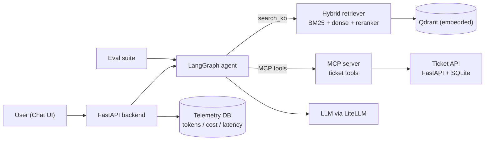

# helpdesk-agent

[](https://www.python.org/)
[](LICENSE)
[](https://github.com/astral-sh/ruff)
[](https://mypy-lang.org/)

An IT helpdesk agent that answers support questions from a Markdown knowledge base with section citations (`[KB-001]`), executes ticket actions over the Model Context Protocol (MCP), logs per-request token/latency/cost telemetry to SQLite, and includes a retrieval & agent evaluation suite. This project was mostly derived from the ISIT-Chatbot I developed during my Internship, with major changes to the LLM used. This mostly just also serves as a demo for a future continued project of mine.

---

## Overview

`helpdesk-agent` simulates an internal IT support system for a fictional company (*Northwind Labs*) with 30 runbook articles (`data/kb/`) and a SQLite-backed ticketing service (`TCK-1001`..`TCK-1010`).

1. **Hybrid Retrieval + Reranking:** Combines lexical BM25 (`rank-bm25`) and local dense embeddings (`fastembed` with `BAAI/bge-small-en-v1.5` stored in Qdrant), merges rankings with Reciprocal Rank Fusion (RRF), and re-scores candidates with a local cross-encoder (`Xenova/ms-marco-MiniLM-L-6-v2`).
2. **Grounded Answers & Confirmation before Mutations:** Answers cite the specific KB articles used. When the knowledge base cannot resolve an issue, the agent offers to open a support ticket and waits for user confirmation before calling `create_ticket`.
3. **MCP Tool Server & Browser Automation:** Ticket operations (`search_tickets`, `get_ticket`, `create_ticket`, `add_comment`, `update_ticket_status`, `check_sla_breaches`, `scrape_ticket_page`, `autofill_ticket_form`) are exposed both in-process and over `stdio` via the `mcp` SDK, with Playwright support for legacy portal scraping and ticket form autofill + screenshot preview.
4. **Telemetry, Streaming & Integrations:** Tracks prompt/completion tokens, latency (`avg`, `p50`, `p95`), estimated cost, retrieved sources, and tool usage in SQLite (`GET /metrics` and InfluxDB line protocol `GET /metrics/influx`), streams progressive SSE events on `POST /chat/stream`, and provides HMAC-verified Slack (`/webhooks/slack`) and Microsoft Teams (`/webhooks/teams`) adapters.



---

## Tech Stack

| Layer | Choice | Notes |
|---|---|---|
| Language | Python 3.11 | Type-checked with `mypy`, linted with `ruff` |
| Agent | LangGraph | `retrieve -> agent <-> tools` state graph with step limits |
| LLM Client | LiteLLM | Works with Gemini, OpenAI, Azure OpenAI, or local Ollama |
| Tool Protocol | MCP (`mcp` SDK) | `stdio` server + in-process fallback |
| Retrieval | `rank-bm25` + `fastembed` + `qdrant-client` | Runs locally on CPU; embedded Qdrant by default |
| Ticketing | FastAPI + SQLModel + SQLite | Seeded with 10 sample IT tickets, SLA tracking, and HTML portal |
| Browser Automation | Playwright (Chromium) | Legacy portal scraping + ticket form autofill & screenshot preview |
| Chat UI | Chainlit | Displays progressive token stream, tool calls, cited sources, and screenshot previews |
| Testing | `pytest` + `pytest-asyncio` | Deterministic fake LLM (`ScriptedLLM`), hashing embedder, and headless Chromium e2e tests |

---

## Quickstart

### 1. Install

```bash
git clone https://github.com/Exryz/helpdesk-agent.git
cd helpdesk-agent

python -m venv .venv
# Windows (PowerShell)
.venv\Scripts\Activate.ps1
# Linux / macOS
source .venv/bin/activate

pip install -e .[dev,ui,browser]
playwright install chromium
```

### 2. Configure `.env`

```bash
cp .env.example .env
```

Set your model and API key in `.env`:

```ini
HELPDESK_LLM_MODEL=gemini/gemini-3.5-flash
GEMINI_API_KEY=your_api_key_here
```

### 3. Build the KB Index

```bash
helpdesk-ingest
# or test a query right away:
python -m helpdesk.ingest --query "VPN keeps disconnecting"
```

### 4. Run the API & Chat UI

Start the FastAPI server:

```bash
uvicorn helpdesk.api.main:app_factory --factory --host 0.0.0.0 --port 8000 --reload
```

Start the Chainlit UI in another terminal:

```bash
chainlit run src/helpdesk/ui/app.py --port 8080
```

- **Chat UI:** `http://localhost:8080`
- **OpenAPI docs:** `http://localhost:8000/docs`
- **Knowledge Base API:** `http://localhost:8000/kb` & `http://localhost:8000/kb/search?q=VPN`
- **SLA Breaches:** `http://localhost:8000/sla/breaches`
- **Telemetry summary:** `http://localhost:8000/metrics` (`http://localhost:8000/metrics/influx` for InfluxDB/Grafana)

### 5. MCP Server Configuration

To expose the ticket tools (`search_tickets`, `get_ticket`, `create_ticket`, `add_comment`, `update_ticket_status`, `check_sla_breaches`, `scrape_ticket_page`, `autofill_ticket_form`) to any MCP client over `stdio`:

```json
{
  "mcpServers": {
    "helpdesk-tickets": {
      "command": "python",
      "args": ["-m", "helpdesk.mcp_server.server"],
      "env": {
        "HELPDESK_TICKETS_DB": "/path/to/helpdesk-agent/.data/tickets.db"
      }
    }
  }
}
```

---

## Retrieval & Evaluation

Documents in `data/kb/` use YAML frontmatter (`id`, `title`, `category`, `tags`) and are split on `##` headings (merging short sections under 200 chars and splitting long sections on paragraph boundaries up to 1,200 chars). Dense vectors are cached in `.data/qdrant` using a SHA-256 corpus fingerprint (`index_state.json`) so startup skips re-indexing when articles have not changed.

### Retrieval Benchmark (`evals/dataset.jsonl`)

Evaluated across the 37 queries with ground-truth KB articles in `evals/dataset.jsonl` (50 total queries: 35 `kb_answer`, 10 `ticket_action`, 5 `out_of_scope`):

| Retrieval Mode | Hit@1 | Hit@3 | Hit@4 | MRR | Recall@4 | Evaluated Rows |
|---|---|---|---|---|---|---|
| `bm25` | 94.6% | 100.0% | 100.0% | 0.9685 | 100.0% | 37 |
| `dense` | 97.3% | 100.0% | 100.0% | 0.9820 | 100.0% | 37 |
| `hybrid` | 94.6% | 100.0% | 100.0% | 0.9730 | 100.0% | 37 |
| `hybrid_rerank` | 94.6% | 97.3% | 100.0% | 0.9662 | 100.0% | 37 |

Re-run the benchmarks locally:

```bash
# Full retrieval benchmark (FastEmbed + Qdrant)
python -m evals.run_evals --mode retrieval

# Fast offline smoke run (hashing embedder, used in CI)
python -m evals.run_evals --mode retrieval --offline --limit 10

# End-to-end agent + LLM-as-judge evaluation (resumable across rate-limit windows)
python -m evals.run_evals --mode agent --resume evals/results/agent_cache.jsonl
```

---

## Project Layout

```text
helpdesk-agent/
├── .github/workflows/ci.yml   # Lint, type-check, unit + Playwright tests, Docker build
├── Dockerfile                 # Container image for API / UI
├── docker-compose.yml         # Qdrant + FastAPI + Chainlit + InfluxDB + Grafana stack
├── pyproject.toml             # Package metadata and ruff/mypy/pytest settings
├── data/kb/                   # 30 synthetic IT knowledge base articles (KB-001..KB-030)
├── evals/
│   ├── dataset.jsonl          # 50 evaluation scenarios
│   ├── judge_prompts.py       # Prompts for faithfulness, relevance, and refusal scoring
│   ├── run_evals.py           # CLI evaluation runner (with --resume cache support)
│   └── results/latest.md      # Latest benchmark summary
├── src/helpdesk/
│   ├── config.py              # Environment / .env settings
│   ├── ingest.py              # CLI to build and query the KB index
│   ├── llm.py                 # LiteLLM client, streaming, rate-limit throttle, and ScriptedLLM
│   ├── telemetry.py           # SQLite request/LLM metrics, conversation history, Influx exporter
│   ├── agent/                 # LangGraph workflow, progressive event stream, and tool backends
│   ├── api/                   # FastAPI application (/chat, /kb, /sla, /webhooks, /metrics)
│   ├── browser/               # Playwright portal scraper and form autofill + screenshot preview
│   ├── mcp_server/            # FastMCP stdio server
│   ├── retrieval/             # Markdown chunker, BM25, Qdrant dense index, RRF, reranker, watcher
│   ├── tickets/               # SQLModel ticket repository, SLA calculator, HTML portal, REST API
│   └── ui/                    # Chainlit chat interface
└── tests/                     # Unit, API, webhook, SLA, KB, and headless Chromium e2e tests
```

---

## Development & Tests

```bash
pytest -q
ruff check .
mypy
```

---

## Roadmap

- [x] Playwright browser automation for scraping legacy portal ticket/asset details and auto-filling ticket forms (with screenshot preview before submit)
- [x] Export SQLite telemetry to InfluxDB + Grafana dashboard
- [x] Streaming token responses on `/chat` (SSE) and in the Chainlit UI
- [x] Persistent conversation history in SQLite
- [x] Slack / Microsoft Teams webhook adapter
- [x] Knowledge Base REST API (`/kb`) for browsing and searching articles
- [x] SLA breach detection and priority escalation alerts (`/sla/breaches`)
- [x] Incremental KB watcher for hot-reloading updated runbooks

---

## License

[MIT](LICENSE) © 2026 Paul Andrei Datinguinoo
