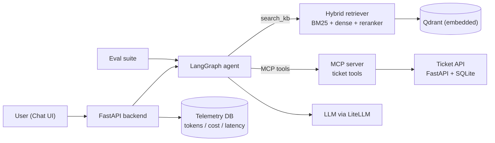

# helpdesk-agent

[](https://www.python.org/)
[](LICENSE)
[](https://github.com/astral-sh/ruff)
[](https://mypy-lang.org/)

An IT helpdesk agent that answers support questions from a Markdown knowledge base with section citations (`[KB-001]`), executes ticket actions over the Model Context Protocol (MCP), logs per-request token/latency/cost telemetry to SQLite, and includes a retrieval & agent evaluation suite. This project was mostly derived from the ISIT-Chatbot I developed during my Internship, with major changes to the LLM used. This mostly just also serves as a demo for a future continued project of mine.

---

## Overview

`helpdesk-agent` simulates an internal IT support system for a fictional company (*Northwind Labs*) with 30 runbook articles (`data/kb/`) and a SQLite-backed ticketing service (`TCK-1001`..`TCK-1010`).

1. **Hybrid Retrieval + Reranking:** Combines lexical BM25 (`rank-bm25`) and local dense embeddings (`fastembed` with `BAAI/bge-small-en-v1.5` stored in Qdrant), merges rankings with Reciprocal Rank Fusion (RRF), and re-scores candidates with a local cross-encoder (`Xenova/ms-marco-MiniLM-L-6-v2`).
2. **Grounded Answers & Confirmation before Mutations:** Answers cite the specific KB articles used. When the knowledge base cannot resolve an issue, the agent offers to open a support ticket and waits for user confirmation before calling `create_ticket`.
3. **MCP Tool Server:** Ticket operations (`search_tickets`, `get_ticket`, `create_ticket`, `add_comment`, `update_ticket_status`) are exposed both in-process and over `stdio` via the `mcp` SDK.
4. **Telemetry:** Tracks prompt/completion tokens, latency (`avg`, `p50`, `p95`), estimated cost, retrieved sources, and tool usage in SQLite, exposed at `GET /metrics`.



---

## Tech Stack

| Layer | Choice | Notes |
|---|---|---|
| Language | Python 3.11 | Type-checked with `mypy`, linted with `ruff` |
| Agent | LangGraph | `retrieve -> agent <-> tools` state graph with step limits |
| LLM Client | LiteLLM | Works with Gemini, OpenAI, Azure OpenAI, or local Ollama |
| Tool Protocol | MCP (`mcp` SDK) | `stdio` server + in-process fallback |
| Retrieval | `rank-bm25` + `fastembed` + `qdrant-client` | Runs locally on CPU; embedded Qdrant by default |
| Ticketing | FastAPI + SQLModel + SQLite | Seeded with 10 sample IT tickets |
| Chat UI | Chainlit | Displays tool calls, cited sources, and request stats |
| Testing | `pytest` + `pytest-asyncio` | Deterministic fake LLM (`ScriptedLLM`) and hashing embedder for offline CI |

---

## Quickstart

### 1. Install

```bash
git clone https://github.com/Exryz/helpdesk-agent.git
cd helpdesk-agent

python -m venv .venv
# Windows (PowerShell)
.venv\Scripts\Activate.ps1
# Linux / macOS
source .venv/bin/activate

pip install -e .[dev,ui]
```

### 2. Configure `.env`

```bash
cp .env.example .env
```

Set your model and API key in `.env`:

```ini
HELPDESK_LLM_MODEL=gemini/gemini-3.5-flash
GEMINI_API_KEY=your_api_key_here
```

### 3. Build the KB Index

```bash
helpdesk-ingest
# or test a query right away:
python -m helpdesk.ingest --query "VPN keeps disconnecting"
```

### 4. Run the API & Chat UI

Start the FastAPI server:

```bash
uvicorn helpdesk.api.main:app_factory --factory --host 0.0.0.0 --port 8000 --reload
```

Start the Chainlit UI in another terminal:

```bash
chainlit run src/helpdesk/ui/app.py --port 8080
```

- **Chat UI:** `http://localhost:8080`
- **OpenAPI docs:** `http://localhost:8000/docs`
- **Telemetry summary:** `http://localhost:8000/metrics`

### 5. MCP Server Configuration

To expose the ticket tools (`search_tickets`, `get_ticket`, `create_ticket`, `add_comment`, `update_ticket_status`) to any MCP client over `stdio`:

```json
{
  "mcpServers": {
    "helpdesk-tickets": {
      "command": "python",
      "args": ["-m", "helpdesk.mcp_server.server"],
      "env": {
        "HELPDESK_TICKETS_DB": "/path/to/helpdesk-agent/.data/tickets.db"
      }
    }
  }
}
```

---

## Retrieval & Evaluation

Documents in `data/kb/` use YAML frontmatter (`id`, `title`, `category`, `tags`) and are split on `##` headings (merging short sections under 200 chars and splitting long sections on paragraph boundaries up to 1,200 chars). Dense vectors are cached in `.data/qdrant` using a SHA-256 corpus fingerprint (`index_state.json`) so startup skips re-indexing when articles have not changed.

### Retrieval Benchmark (`evals/dataset.jsonl`)

Evaluated across the 37 queries with ground-truth KB articles in `evals/dataset.jsonl` (50 total queries: 35 `kb_answer`, 10 `ticket_action`, 5 `out_of_scope`):

| Retrieval Mode | Hit@1 | Hit@3 | Hit@4 | MRR | Recall@4 | Evaluated Rows |
|---|---|---|---|---|---|---|
| `bm25` | 94.6% | 100.0% | 100.0% | 0.9685 | 100.0% | 37 |
| `dense` | 97.3% | 100.0% | 100.0% | 0.9820 | 100.0% | 37 |
| `hybrid` | 94.6% | 100.0% | 100.0% | 0.9730 | 100.0% | 37 |
| `hybrid_rerank` | 94.6% | 97.3% | 100.0% | 0.9662 | 100.0% | 37 |

Re-run the benchmarks locally:

```bash
# Full retrieval benchmark (FastEmbed + Qdrant)
python -m evals.run_evals --mode retrieval

# Fast offline smoke run (hashing embedder, used in CI)
python -m evals.run_evals --mode retrieval --offline --limit 10

# End-to-end agent + LLM-as-judge evaluation
python -m evals.run_evals --mode agent
```

---

## Project Layout

```text
helpdesk-agent/
├── .github/workflows/ci.yml   # Lint, type-check, unit tests, offline eval smoke test
├── Dockerfile                 # Container image for API / UI
├── docker-compose.yml         # Qdrant + FastAPI + Chainlit stack
├── pyproject.toml             # Package metadata and ruff/mypy/pytest settings
├── data/kb/                   # 30 synthetic IT knowledge base articles (KB-001..KB-030)
├── evals/
│   ├── dataset.jsonl          # 50 evaluation scenarios
│   ├── judge_prompts.py       # Prompts for faithfulness, relevance, and refusal scoring
│   ├── run_evals.py           # CLI evaluation runner
│   └── results/latest.md      # Latest benchmark summary
├── src/helpdesk/
│   ├── config.py              # Environment / .env settings
│   ├── ingest.py              # CLI to build and query the KB index
│   ├── llm.py                 # LiteLLM client, rate-limit throttle, and ScriptedLLM test double
│   ├── telemetry.py           # SQLite request & LLM call metrics
│   ├── agent/                 # LangGraph workflow, prompts, and local/MCP tool backends
│   ├── api/                   # FastAPI application (/chat, /health, /metrics, /tickets)
│   ├── mcp_server/            # FastMCP stdio server
│   ├── retrieval/             # Markdown chunker, BM25, Qdrant dense index, RRF, reranker
│   ├── tickets/               # SQLModel ticket repository, tools, and REST router
│   └── ui/                    # Chainlit chat interface
└── tests/                     # Unit and integration tests (offline, no API key required)
```

---

## Development & Tests

```bash
pytest -q
ruff check .
mypy
```

---

## Roadmap

- [ ] Export SQLite telemetry to InfluxDB + Grafana dashboard
- [ ] Streaming token responses on `/chat` (SSE) and in the Chainlit UI
- [ ] Persistent conversation history in SQLite
- [ ] Slack / Microsoft Teams webhook adapter

---

## License

[MIT](LICENSE) © 2026 Paul Andrei Datinguinoo
